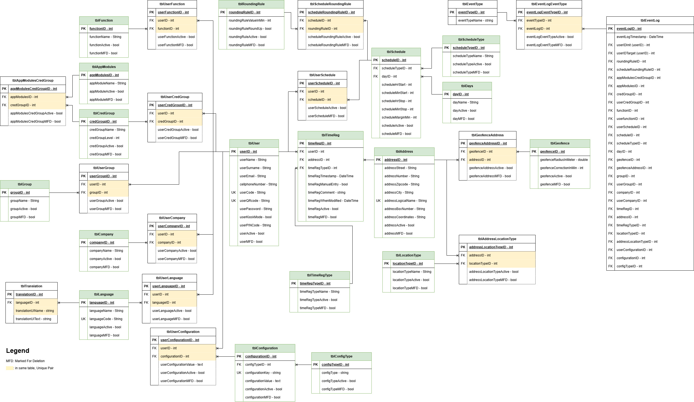

# Jitan Database ERD



Authoritative structural reference: [ERD.jpg](ERD.jpg) (ERD version *2026-09-24 – ERD-organized*).
This document explains what each table **means in Jitan**. If this document and the image
ever disagree, the image wins. Fix this document.

Open questions where Jitan requirements don't fit the ERD: [ERD_GAPS.md](ERD_GAPS.md).

---

## Database rules

**The ERD is fixed and is the database source of truth.**

Do **not**:

- create migrations
- add tables or columns
- rename columns
- repurpose a field because it looks convenient
- create backend-only database concepts to hide a missing relationship

A schema change happens only after it has been discussed with IT and explicitly approved.

### Notation

| Mark | Meaning |
|---|---|
| PK | Primary Key |
| FK | Foreign Key |
| UK | Unique Key |
| MFD | Marked For Deletion |
| Yellow paired fields | The FK pair is a **unique combination** within that junction table |

Example: in `tblUserCompany`, the pair `userID + companyID` is unique, so the same
user/company combination cannot be inserted twice.

### Active + MFD lifecycle

Most entities carry `<entity>Active` and `<entity>MFD`.

| State | Meaning | Shown in Jitan UI |
|---|---|---|
| `Active = true`, `MFD = false` | Normal, in use | Yes |
| `Active = false`, `MFD = false` | Disabled but kept, e.g. a disabled company | Yes, marked inactive |
| `MFD = true` | Soft-deleted | No |

- **No physical `DELETE`** on business or master data. "Delete" sets `MFD = true`.
- Every application read filters `MFD = false`. Lists that offer only selectable values
  also filter `Active = true`.
- **Junction tables.** `tblUserCompany` and `tblUserGroup` have Active/MFD (IT decision
  2026-10-08). Removing such an assignment sets `Active = false` and `MFD = true`; the row
  stays and the change is recorded in `tblEventLog`. Adding it again reactivates the same
  row (the unique pair forbids a second one). No junction row is ever physically deleted.
  The other junction tables have no Active/MFD; their assignments cannot be removed
  through Jitan until IT decides (CLARIFY-09).
- `tblEventLog`, `tblEventType` and `tblEventLogEventType` have no Active/MFD. They are
  append-only.

### Column names

Use column names **exactly** as spelled in the ERD, including inconsistencies such as
`userQRcode` and `tblEventLog.userfunctionID`. Before writing the first repository,
verify the live spellings with `INFORMATION_SCHEMA.COLUMNS`. MySQL column names are
case-insensitive, but Dart model mapping is not.

---

## Concept → table map

| Jitan concept | ERD representation |
|---|---|
| Employee / user | `tblUser` |
| Employee code (login) | `tblUser.userCode` (UK) |
| Employee personal QR | `tblUser.userQRcode` (UK) |
| Company | `tblCompany` |
| Employee belongs to company | `tblUserCompany`, many-to-many |
| Employee type (blue/white collar) | `tblGroup` via `tblUserGroup` |
| Access role (Employee / HR / Admin) | `tblCredGroup` via `tblUserCredGroup` |
| Which screens a role may open | `tblAppModules` via `tblAppModulesCredGroup` |
| Specific capability (correct time, export…) | `tblFunction` via `tblUserFunction` |
| Language preference | `tblLanguage` via `tblUserLanguage` |
| UI translations | `tblTranslation` |
| Work period / break / lunch / travel | `tblSchedule` with a `tblScheduleType` |
| Which schedules apply to an employee | `tblUserSchedule` |
| Rounding | `tblRoundingRule` via `tblScheduleRoundingRule` |
| Workplace / site / location | `tblAddress` |
| Location category | `tblLocationType` via `tblAddressLocationType` |
| Geofence | `tblGeofence` via `tblGeofenceAddress` |
| Time registration event | `tblTimeReg` with a `tblTimeRegType` |
| Audit trail | `tblEventLog` with `tblEventType` via `tblEventLogEventType` |

**"Work policy" is not a table.** What the roadmap calls a policy (§19) is spread across
`tblGroup`, `tblScheduleType`, `tblSchedule`, `tblRoundingRule`, `tblGeofence` and
`tblTimeRegType`. Check all of them before calling a policy requirement a gap.

---

# User and organisation

## `tblUser`

The central person/identity. Every employee, HR user and admin is a row here.

| Column | Type | Key | Jitan meaning |
|---|---|---|---|
| `userID` | int | PK | |
| `userName` | String | | **First name**. Not a login username. |
| `userSurname` | String | | Last name |
| `userEmail` | String | | Optional. Jitan does not require email anywhere. |
| `cellphoneNumber` | String | | Optional phone |
| `userCode` | String | UK | **Employee code**, the login identity (e.g. `SBW`) |
| `userQRcode` | String | UK | Value encoded in the employee's **personal QR**, used for Terminal registration only |
| `userPassword` | String | | Password **hash**. Never plaintext, never returned by the API, never logged, never visible to HR/Admin. |
| `userKioskMode` | bool | | Kiosk/terminal-style access, where applicable |
| `userPINCode` | String | | PIN for kiosk-style access. Hashed like the password. |
| `userActive` | bool | | |
| `userMFD` | bool | | |

Connected to: companies, groups, credential groups, functions, languages, schedules,
time registrations, and event log (as actor `userIDInit` or subject `userIDTarget`).

## `tblCompany`

A company, e.g. Almeco, PCA, Akwa Plus, Proceq.

| Column | Type | Key |
|---|---|---|
| `companyID` | int | PK |
| `companyName` | String | |
| `companyActive` | bool | |
| `companyMFD` | bool | |

"Disable company" sets `companyActive = false`. "Delete company" sets `companyMFD = true`.
The company is not stored on the user; membership is in `tblUserCompany`.

## `tblUserCompany`

User ↔ company membership. Unique pair: `userID + companyID`.

| Column | Type | Key |
|---|---|---|
| `userCompanyID` | int | PK |
| `userID` | int | FK → `tblUser` |
| `companyID` | int | FK → `tblCompany` |
| `userCompanyActive` | bool | |
| `userCompanyMFD` | bool | |

`userCompanyActive` / `userCompanyMFD` were approved by IT on 2026-10-08 (names follow
the ERD convention; to be confirmed against IT's updated specification). A membership
counts only while `Active = true AND MFD = false`.

One employee can belong to several companies with a single account (IT, 2026-10-08):

```text
Disan → Almeco
Disan → PCA
```

**Company scoping:** when HR manages Almeco, the employee list is
`tblUser JOIN tblUserCompany WHERE companyID = <Almeco>`. PCA-only employees never appear.
The server enforces this in the repository/service layer, not only in the UI.

---

# Employee grouping

## `tblGroup`

**Universal across companies** (IT decision, 2026-10-08): `tblGroup` has no company and
none is added. An employee's groups (`tblUserGroup`) apply in all their companies. Group
membership never grants company access; that comes only from `tblUserCompany` and
permissions. Company-specific groups would need IT approval first.

Employee category. This **is** Jitan's "employee type" (roadmap §7).

| Column | Type | Key |
|---|---|---|
| `groupID` | int | PK |
| `groupName` | String | |
| `groupActive` | bool | |
| `groupMFD` | bool | |

Examples: `Blue collar`, `White collar`.

Do not create an `EmployeeType` table or an `employeeType` column.

## `tblUserGroup`

User ↔ group. Unique pair: `userID + groupID`.

| Column | Type | Key |
|---|---|---|
| `userGroupID` | int | PK |
| `userID` | int | FK → `tblUser` |
| `groupID` | int | FK → `tblGroup` |
| `userGroupActive` | bool | |
| `userGroupMFD` | bool | |

`userGroupActive` / `userGroupMFD` approved by IT on 2026-10-08, as for `tblUserCompany`.

```text
Kevin  → White collar
Thomas → Blue collar
```

---

# Roles, credentials and authorization

Authorization has two layers:

```text
tblCredGroup  = broad access role        (Employee / HR / Admin)
tblFunction   = specific user capability (Correct time, Export report, …)
```

`tblCredGroup` is about **access level**. It is never used for blue/white collar.

## `tblCredGroup`

| Column | Type | Key | Jitan meaning |
|---|---|---|---|
| `credGroupID` | int | PK | |
| `credGroupName` | String | | `Employee`, `HR`, `Admin` |
| `credGroupLevel` | int | | Relative authorization level, per the existing system's rules |
| `credGroupActive` | bool | | |
| `credGroupMFD` | bool | | |

## `tblUserCredGroup`

User ↔ credential group. Unique pair: `userID + credGroupID`.

| Column | Type | Key |
|---|---|---|
| `userCredGroupID` | int | PK |
| `userID` | int | FK → `tblUser` |
| `credGroupID` | int | FK → `tblCredGroup` |

```text
Disan → Admin
Kevin → Employee
```

## `tblAppModules`

Application areas a role can reach.

| Column | Type | Key |
|---|---|---|
| `appModulesID` | int | PK |
| `appModuleName` | String | |
| `appModuleActive` | bool | |
| `appModuleMFD` | bool | |

Possible values: Employees, Companies, Reports, Time records, Exceptions, Terminals.
**Read module names from the database.** Do not hardcode or invent them in the backend.

## `tblAppModulesCredGroup`

Credential group ↔ module. Unique pair: `appModulesID + credGroupID`.

| Column | Type | Key |
|---|---|---|
| `appModulesCredGroupID` | int | PK |
| `appModulesID` | int | FK → `tblAppModules` |
| `credGroupID` | int | FK → `tblCredGroup` |

```text
Admin    → Employees, Reports, …
HR       → Employees, …
Employee → Employee application
```

The HR/Admin web navigation (roadmap §30) is built from these rows for the signed-in
user. HR and Admin seeing the same screens in V1 is a data choice, not a code choice.

## `tblFunction`

A specific capability.

| Column | Type | Key |
|---|---|---|
| `functionID` | int | PK |
| `functionName` | String | |
| `functionActive` | bool | |
| `functionMFD` | bool | |

Possible values: Add employee, Correct time, Export report, Resolve exception, Manage
terminal. **Read the actual values from the database.**

## `tblUserFunction`

User ↔ function. Unique pair: `userID + functionID`.

| Column | Type | Key |
|---|---|---|
| `userFunctionID` | int | PK |
| `userID` | int | FK → `tblUser` |
| `functionID` | int | FK → `tblFunction` |

Grants specific capabilities at user level, independent of role.

### Authorization check, conceptually

```text
Can user U open module M?
  → U ∈ tblUserCredGroup → credGroup C
  → (M, C) ∈ tblAppModulesCredGroup

Can user U perform function F?
  → (U, F) ∈ tblUserFunction
```

All filtered on Active/MFD of the role, module and function rows.
*(To confirm with IT: whether a function needs **both** module access and a function
grant, or a function grant alone.)*

---

# Languages and translations

## `tblLanguage`

| Column | Type | Key |
|---|---|---|
| `languageID` | int | PK |
| `languageName` | String | |
| `languageCode` | String | UK |
| `languageActive` | bool | |
| `languageMFD` | bool | |

Examples: Dutch / `nl`, French / `fr`, German / `de`. Jitan may grow to 50+ languages,
so **the UI never assumes a fixed list**. The language picker reads this table.

English is **built into the apps** (the guaranteed default and fallback, I18N-01). It may
also have a row here if the database needs one, but the apps never depend on it.

## `tblUserLanguage`

User ↔ language. Unique pair: `userID + languageID`.

| Column | Type | Key |
|---|---|---|
| `userLanguageID` | int | PK |
| `userID` | int | FK → `tblUser` |
| `languageID` | int | FK → `tblLanguage` |

Holds the user's language preference according to the existing system logic.

## `tblTranslation`

UI strings per language. Unique pair: `languageID + translationUIName` (yellow in
ERD.jpg): a key appears at most once per language.

| Column | Type | Key | Jitan meaning |
|---|---|---|---|
| `translationID` | int | PK | |
| `languageID` | int | FK → `tblLanguage` | |
| `translationUIName` | string | | Stable translation **key**, e.g. `employee.home.welcome` |
| `translationUIText` | string | | Translated text, e.g. `Welcome` / `Welkom` / `Bienvenue` |

The source of truth for every **non-English** language. English is the one built-in
bundle (`builtInEnglish` in `packages/jitan_core`); a missing translation here falls back
to it key by key. There are no ARB or JSON translation files.

---

# Schedule system

```text
tblUserSchedule → tblSchedule ─┬→ tblScheduleType   (what kind of period)
                               ├→ tblDays           (which day)
                               └→ tblScheduleRoundingRule → tblRoundingRule
```

## `tblScheduleType`

What kind of period a schedule row represents.

| Column | Type | Key |
|---|---|---|
| `scheduleTypeID` | int | PK |
| `scheduleTypeName` | String | |
| `scheduleTypeActive` | bool | |
| `scheduleTypeMFD` | bool | |

Examples: `Work`, `Break`, `Lunch`, `Travel`.

This is how "break duration" and similar policy concepts are represented. A break is a
schedule row of type Break, not a policy field.

## `tblDays`

| Column | Type | Key |
|---|---|---|
| `dayID` | int | PK |
| `dayName` | String | |
| `dayActive` | bool | |
| `dayMFD` | bool | |

Monday … Sunday.

## `tblSchedule`

A reusable, **global** scheduled period on one day.

| Column | Type | Key | Jitan meaning |
|---|---|---|---|
| `scheduleID` | int | PK | |
| `scheduleTypeID` | int | FK → `tblScheduleType` | Work / Break / … |
| `dayID` | int | FK → `tblDays` | |
| `scheduleHrStart` | int | | Start hour (0–23) |
| `scheduleMinStart` | int | | Start minute (0–59) |
| `scheduleHrStop` | int | | Stop hour |
| `scheduleMinStop` | int | | Stop minute |
| `scheduleMarginMin` | int | | Margin in minutes, per the database design |
| `scheduleActive` | bool | | |
| `scheduleMFD` | bool | | |

```text
Monday · Work  · 08:00 → 16:30
Monday · Break · 12:00 → 12:30
```

Schedules are global and reusable. **No `companyID` on this table.** A full week for one
employee means several `tblSchedule` rows (one per day per type), all linked through
`tblUserSchedule`.

## `tblUserSchedule`

User ↔ schedule. Unique pair: `userID + scheduleID`.

| Column | Type | Key |
|---|---|---|
| `userScheduleID` | int | PK |
| `userID` | int | FK → `tblUser` |
| `scheduleID` | int | FK → `tblSchedule` |

Decides which global schedules apply to which employee. Not modified for multi-company
reasons. If company-specific schedule assignment turns out to be needed, that's an
ERD gap (see [ERD_GAPS.md](ERD_GAPS.md)).

---

# Rounding

## `tblRoundingRule`

| Column | Type | Key | Jitan meaning |
|---|---|---|---|
| `roundingRuleID` | int | PK | |
| `roundingRuleValueInMin` | int | | Rounding interval/value in minutes |
| `roundingRuleRoundUp` | bool | | Rounding direction |
| `roundingRuleActive` | bool | | |
| `roundingRuleMFD` | bool | | |

## `tblScheduleRoundingRule`

Schedule ↔ rounding rule. Unique pair: `scheduleID + roundingRuleID`.

| Column | Type | Key |
|---|---|---|
| `scheduleRoundingRuleID` | int | PK |
| `scheduleID` | int | FK → `tblSchedule` |
| `roundingRuleID` | int | FK → `tblRoundingRule` |

Rounding is attached to **schedules**. No company field. The backend applies it when it
calculates registered time.

The backend keeps **actual detected time** and **registered/rounded time** as separate
concepts. How both are persisted with a single `tblTimeReg` timestamp is an open item:
see [ERD_GAPS.md](ERD_GAPS.md).

---

# Time registration

## `tblTimeRegType`

| Column | Type | Key |
|---|---|---|
| `timeRegTypeID` | int | PK |
| `timeRegTypeName` | String | |
| `timeRegTypeActive` | bool | |
| `timeRegTypeMFD` | bool | |

The kind of registration event. **Read the configured values from the database.** The
backend does not hardcode type IDs or names without checking them first.

## `tblTimeReg`

The central operational table: one row per time-registration event.

| Column | Type | Key | Jitan meaning |
|---|---|---|---|
| `timeRegID` | int | PK | |
| `userID` | int | FK → `tblUser` | Who |
| `addressID` | int | FK → `tblAddress` | Where |
| `timeRegTypeID` | int | FK → `tblTimeRegType` | What kind of event |
| `timeRegTimestamp` | DateTime | | When |
| `timeRegManualEntry` | bool | | `true` = entered by a person (employee correction / HR), `false` = detected (geofence, QR) |
| `timeRegComment` | string | | Required/encouraged comment on corrections (roadmap §23, §34) |
| `timeRegWhenModified` | DateTime | | Last modification moment |
| `timeRegActive` | bool | | |
| `timeRegMFD` | bool | | |

Covers registrations from QR, geofence and manual flows, distinguished by type and
`timeRegManualEntry`. Historical registrations are never physically deleted.

Work sessions (roadmap §15) are **derived** from the ordered `tblTimeReg` stream per
user. There is no work-session table.

---

# Addresses and locations

## `tblAddress`

A physical place: company site, office, project location, customer site, hotel, any
recognized workplace.

| Column | Type | Key | Jitan meaning |
|---|---|---|---|
| `addressID` | int | PK | |
| `addressStreet` | String | | |
| `addressNumber` | String | | |
| `addressBoxNumber` | String | | |
| `addressZipcode` | String | | |
| `addressCity` | String | | |
| `addressLogicalName` | String | UK | Human-readable name, e.g. `Almeco office` |
| `addressCoordinates` | String | | Lat/lng for geofencing. The string format must be confirmed and validated on write. |
| `addressActive` | bool | | |
| `addressMFD` | bool | | |

## `tblLocationType`

| Column | Type | Key |
|---|---|---|
| `locationTypeID` | int | PK |
| `locationTypeName` | String | |
| `locationTypeActive` | bool | |
| `locationTypeMFD` | bool | |

Location categories (office, customer site, project location, …) as configured in the
database.

## `tblAddressLocationType`

Address ↔ location type. Unique pair: `addressID + locationTypeID`.

| Column | Type | Key |
|---|---|---|
| `addressLocationTypeID` | int | PK |
| `addressID` | int | FK → `tblAddress` |
| `locationTypeID` | int | FK → `tblLocationType` |

An address can carry one or more location types.

---

# Geofencing

## `tblGeofence`

Geofence behaviour/settings.

| Column | Type | Key | Jitan meaning |
|---|---|---|---|
| `geofenceID` | int | PK | |
| `geofenceRadiusInMeter` | double | | Radius, e.g. `50`. UI range 25–200 m, 50–100 recommended. |
| `geofenceCorrectionInMin` | int | | Part of the existing geofence timing/correction model. Interpret per the intended server logic. *(To confirm with IT.)* |
| `geofenceActive` | bool | | |
| `geofenceMFD` | bool | | |

## `tblGeofenceAddress`

Geofence ↔ address. Unique pair: `geofenceID + addressID`.

| Column | Type | Key |
|---|---|---|
| `geofenceAddressID` | int | PK |
| `geofenceID` | int | FK → `tblGeofence` |
| `addressID` | int | FK → `tblAddress` |

Says which addresses are monitored with which geofence configuration. One geofence
configuration (e.g. "50 m, standard correction") can be reused across many addresses.

**Geofence set for an employee's device** = active, non-MFD addresses with a
`tblGeofenceAddress` link, joined to their `tblGeofence` settings.

---

# Event logging and auditing

## `tblEventType`

| Column | Type | Key |
|---|---|---|
| `eventTypeID` | int | PK |
| `eventTypeName` | string | |

The classification of an audit event.

## `tblEventLogEventType`

Event log ↔ event type. Unique pair: `eventTypeID + eventLogID`.

| Column | Type | Key |
|---|---|---|
| `eventLogEventTypeID` | int | PK |
| `eventTypeID` | int | FK → `tblEventType` |
| `eventLogID` | int | FK → `tblEventLog` |

One log entry can carry several event types.

## `tblEventLog`

The central audit trail. One wide row per event; each FK is nullable and set only when
that entity is involved.

| Column | Type | References |
|---|---|---|
| `eventLogID` | int | PK |
| `eventLogTimestamp` | DateTime | |
| `userIDInit` | int | `tblUser` (**who acted**) |
| `userIDTarget` | int | `tblUser` (**who it was done to**) |
| `roundingRuleID` | int | `tblRoundingRule` |
| `scheduleRoundingRuleID` | int | `tblScheduleRoundingRule` |
| `appModulesCredGroupID` | int | `tblAppModulesCredGroup` |
| `appModulesID` | int | `tblAppModules` |
| `credGroupID` | int | `tblCredGroup` |
| `userCredGroupID` | int | `tblUserCredGroup` |
| `functionID` | int | `tblFunction` |
| `userfunctionID` | int | `tblUserFunction` |
| `userScheduleID` | int | `tblUserSchedule` |
| `scheduleID` | int | `tblSchedule` |
| `scheduleTypeID` | int | `tblScheduleType` |
| `dayID` | int | `tblDays` |
| `geofenceID` | int | `tblGeofence` |
| `geofenceAddressID` | int | `tblGeofenceAddress` |
| `groupID` | int | `tblGroup` |
| `userGroupID` | int | `tblUserGroup` |
| `companyID` | int | `tblCompany` |
| `userCompanyID` | int | `tblUserCompany` |
| `timeRegID` | int | `tblTimeReg` |
| `addressID` | int | `tblAddress` |
| `timeRegTypeID` | int | `tblTimeRegType` |
| `locationTypeID` | int | `tblLocationType` |
| `addressLocationTypeID` | int | `tblAddressLocationType` |

Log every consequential action here, never in a separate logging table:

```text
employee created         → userIDInit=HR,  userIDTarget=employee, eventType=…
role changed             → userIDTarget, userCredGroupID
group changed            → userIDTarget, userGroupID
time corrected           → userIDTarget, timeRegID
manual registration      → userIDTarget, timeRegID
schedule modified        → scheduleID
geofence changed         → geofenceID / geofenceAddressID
company created/disabled → companyID
```

Every business write and its event-log insert run in **one database transaction**.
*(Event type names come from `tblEventType`. Confirm the seeded list with IT before
inventing new ones.)*

---

# Relationship overview

```text
tblUser
 ├── tblUserCompany ─────────────→ tblCompany
 │
 ├── tblUserGroup ───────────────→ tblGroup
 │
 ├── tblUserCredGroup ───────────→ tblCredGroup
 │                                      │
 │                                      ↓
 │                             tblAppModulesCredGroup
 │                                      │
 │                                      ↓
 │                                tblAppModules
 │
 ├── tblUserFunction ────────────→ tblFunction
 │
 ├── tblUserLanguage ────────────→ tblLanguage
 │                                      │
 │                                      ↓
 │                                tblTranslation
 │
 ├── tblUserSchedule ────────────→ tblSchedule
 │                                      │
 │                                      ├── tblScheduleType
 │                                      ├── tblDays
 │                                      │
 │                                      ↓
 │                           tblScheduleRoundingRule
 │                                      │
 │                                      ↓
 │                               tblRoundingRule
 │
 └── tblTimeReg
          ├── tblTimeRegType
          └── tblAddress
                    │
                    ├── tblAddressLocationType
                    │          ↓
                    │    tblLocationType
                    │
                    └── tblGeofenceAddress
                               ↓
                         tblGeofence
```

Auditing spans the whole domain:

```text
tblEventLog
     ↓
tblEventLogEventType
     ↓
tblEventType
```

---

# Mapping a concept to the ERD

Before adding any backend model, service, endpoint or query, map the concept to the ERD:

```text
1. Does an existing ERD table represent the concept?
        ↓ yes → use that table.

2. Is it represented through an existing relationship / junction table?
        ↓ yes → use that relationship.

3. Is it represented through a type table?
   (tblGroup, tblScheduleType, tblTimeRegType, tblLocationType,
    tblCredGroup, tblFunction, tblEventType)
        ↓ yes → use the type system.

4. Can it genuinely not be represented?
        ↓
   STOP. Report an ERD GAP.
```

Do not jump from step 1 straight to creating a new backend concept.

---

# ERD Gap Policy

If a Jitan feature cannot be represented cleanly by the existing schema:

1. **Do not modify the schema.**
2. **Do not implement a backend workaround**: no repurposed columns, no encoded values
   stuffed into string fields, no side tables, no "temporary" in-memory substitutes for
   persistent data.
3. Record it in [ERD_GAPS.md](ERD_GAPS.md) as:

   > **ERD GAP — requires clarification with IT.**

   with:
   1. the Jitan requirement (roadmap section)
   2. which existing tables were considered
   3. why they cannot represent the requirement correctly
   4. what information/relationship appears to be missing
4. **Stop that part of the implementation** until it is clarified. Keep building
   everything that doesn't depend on it.

When IT resolves a gap, record the decision in [ERD_GAPS.md](ERD_GAPS.md), update
[ERD.jpg](ERD.jpg) if the schema changed, and update this document to match.
